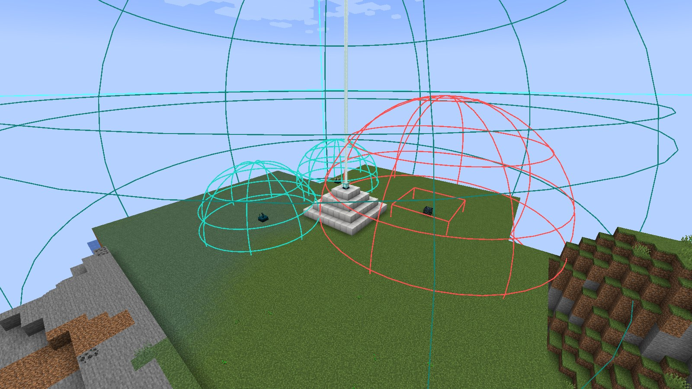
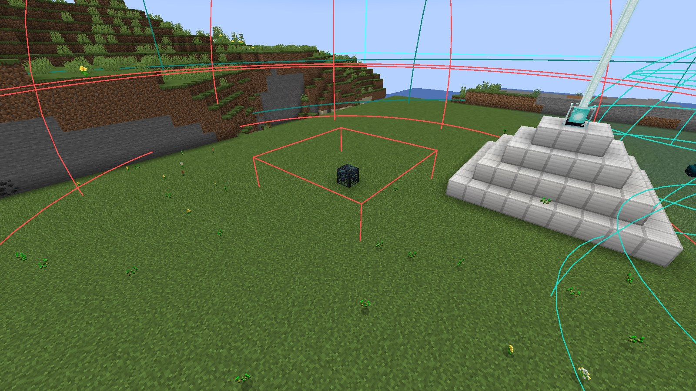
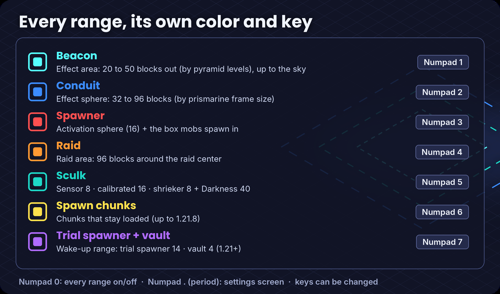
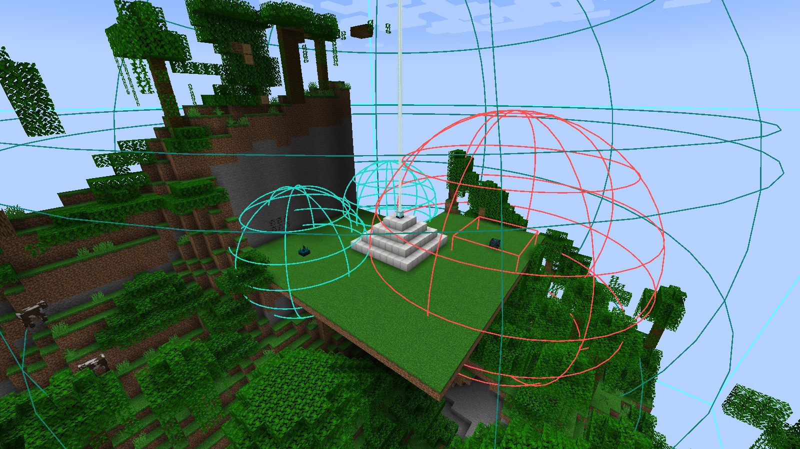
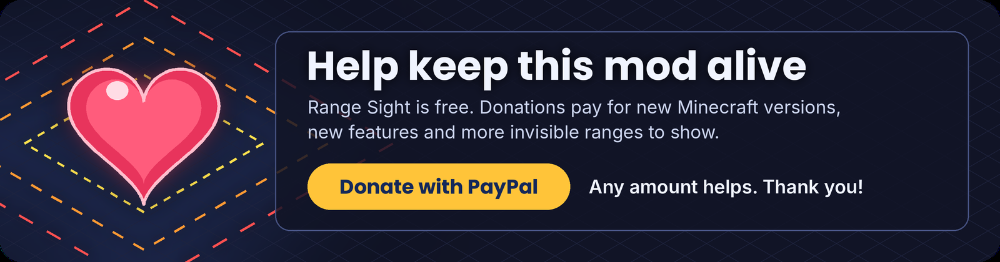

**Stop guessing. See the range.**

Is the spawner close enough to activate? Does the beacon reach your base? Will the sculk sensor hear you? Minecraft never shows you, so you guess, walk, count blocks and guess again. **Range Sight draws every invisible range right in your world.**

---

🧩 **Works on any server.** Range Sight is client-side, so you can use it in single player and on servers that don't have it installed.

## 🔥 What it does

### 🔦 Beacon range
See the exact area your beacon's effects reach, from the ground up to the sky. Range Sight counts the pyramid levels for you, so a 1-level beacon shows 20 blocks and a full pyramid shows 50.

### 🌊 Conduit range
See the sphere where a conduit gives Conduit Power. The size comes from your prismarine frame, from 32 up to 96 blocks.

### 🕷️ Spawner range
See the 16-block sphere you have to be inside for a spawner to work, plus the box its mobs can spawn in. Perfect for building mob farms and AFK spots.

### 🚩 Raid range
See the 96-block area around a raid's center, so you know where raiders can come from (single player and LAN host).

### 👂 Sculk ranges
See how far a sculk sensor (8 blocks) and a calibrated sensor (16) can hear you, and both rings of a shrieker: the 8 blocks it listens to and the 40 blocks its Darkness reaches.

### 🗺️ Spawn chunks
See which chunks stay loaded around world spawn, for farms that keep running while you're away (Minecraft 1.12.2 to 1.21.8, since newer versions no longer have spawn chunks).

### 🎨 Its own color for every range
Every type has its own color, so you always know what you're looking at. Change any color to the one you like.

### ⚡ No lag
Range Sight looks for range blocks once a second, not every frame, and draws all the outlines in one go. Only the closest 48 are drawn.

### 💾 It remembers
Which ranges are on and your colors are saved to `config/rangesight.json`.

## 🎮 Controls
| Key | What it does |
|---|---|
| **Numpad 1** | Beacon range on / off |
| **Numpad 2** | Conduit range on / off |
| **Numpad 3** | Spawner range on / off |
| **Numpad 4** | Raid range on / off |
| **Numpad 5** | Sculk ranges on / off |
| **Numpad 6** | Spawn chunks on / off |
| **Numpad 0** | Every range on / off |

Change any key in Options → Controls → Key Binds. All ranges start off, so turn on the ones you need.

## 📦 Requirements
- **Forge:** Minecraft 1.12.2, 1.16.5, 1.18.2, 1.19.2, 1.20.1, 1.21.1, 1.21.11, 26.1, 26.2 and 26.3
- **NeoForge:** Minecraft 1.20.1, 1.21.1, 1.21.11, 26.1, 26.2 and 26.3
- **Paper:** want this on your server for everyone? Get **[Range Sight Plugin](https://www.curseforge.com/minecraft/bukkit-plugins/range-sight)**.
- Pick the file for your Minecraft version and loader on the Files tab.
- Client-side only. Install it on your own game; servers don't need it.

⚠️ The raid range needs to know where the raid is, which only the server knows. In this mod it works in single player and when you host a LAN world. On servers, use Range Sight Plugin.
Source and bug reports: https://github.com/CosmicLogic0/range-sight

---

## ❤️ Support the mod

Range Sight is free. Donations keep the mod up to date with fixes, new Minecraft versions and new features. [Donate with PayPal](https://www.paypal.com/paypalme/DylanEMason) - any amount helps. Thank you!

---

## 🎮 The creator's server
**Logic Survival** (`play.logicsurvival.fyi`) is the survival server run by the maker of this mod. Range Sight does **not** add it, or anything else, to your server list. Want to visit? Add it yourself in Multiplayer.
