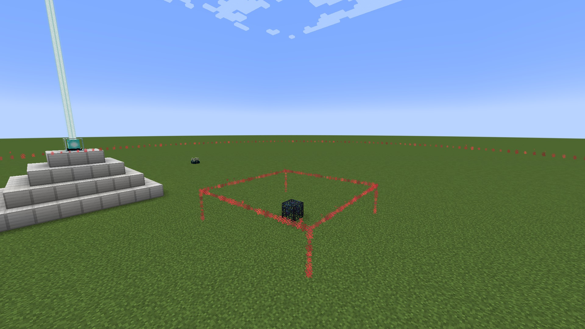
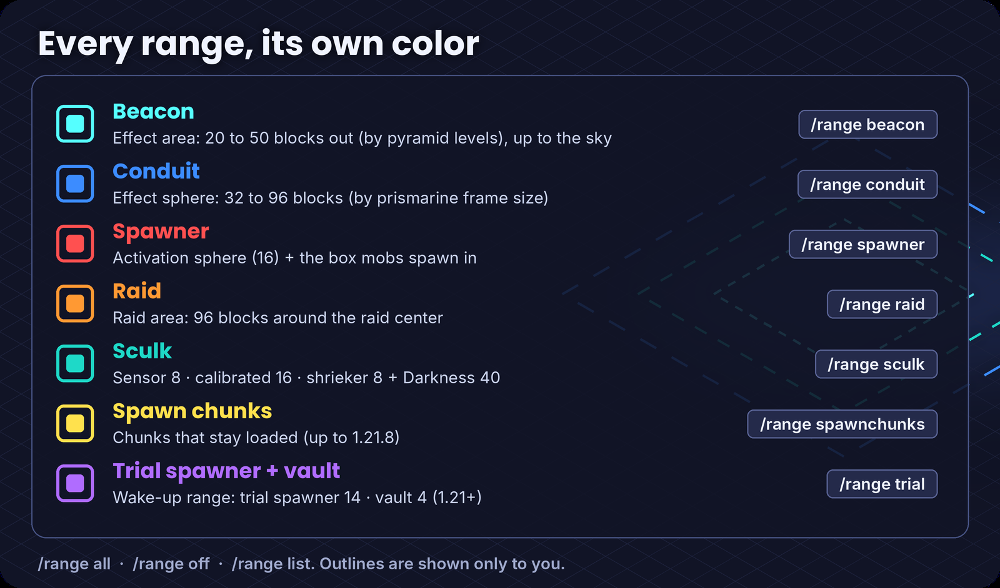
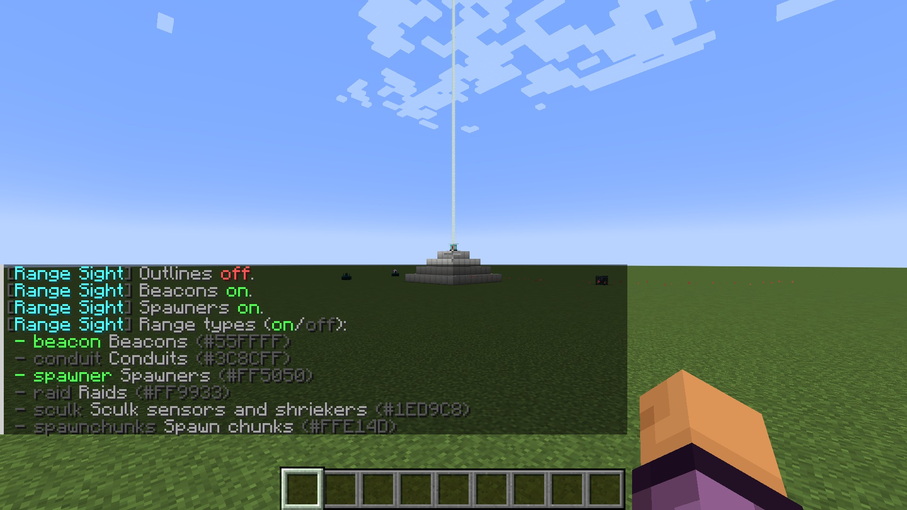
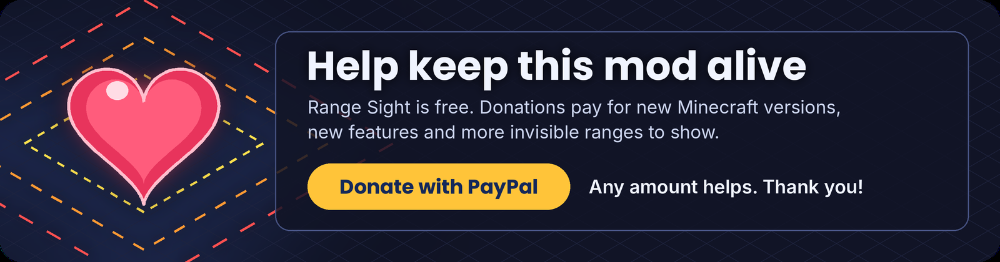

**Type /range. See the range.**

> ⚠️ **Requires [LogicLib Plugin](https://www.curseforge.com/minecraft/bukkit-plugins/logiclib-plugin) 0.2.0 or newer.** Put it in your `plugins` folder too. The CurseForge app adds it for you automatically.

Your players keep asking: is the spawner close enough? Does the beacon reach my house? Will the sculk sensor hear me? **Range Sight Plugin lets every player see the invisible ranges with one command**, no mods needed.

This is the **server plugin** version of [Range Sight](https://www.curseforge.com/minecraft/mc-mods/range-sight). Players don't install anything.

🆕 **1.1.0:** outlines are visible from far away, trial spawner and vault ranges, `/range help`, `/range reload` and a `config.yml` for owners.

---

🧩 **Only you see your outlines.** Each player turns on their own ranges, and the particle outlines are shown only to them, so nobody else's screen gets busy.

## 🔥 What it does

### 🔦 Beacon range
Shows the exact area a beacon's effects reach, from the ground up to the sky, based on how many pyramid levels it has.

### 🌊 Conduit range
Shows the sphere where a conduit gives Conduit Power, sized by its prismarine frame (Minecraft 1.13 and up).

### 🕷️ Spawner range
Shows the 16-block sphere a player has to be inside for a spawner to work, plus the box its mobs spawn in.

### 🚩 Raid range
Shows the 96-block area around an active raid's center. Because the plugin runs on the server, this works for everyone (Minecraft 1.14 and up).

### 👂 Sculk ranges
Shows how far sculk sensors, calibrated sensors and shriekers can hear, and how far a shrieker's Darkness reaches (Minecraft 1.19 and up).

### 🗺️ Spawn chunks
Shows which chunks stay loaded around world spawn (up to Minecraft 1.21.8, since newer versions no longer have spawn chunks).

### ⏳ Trial spawners and vaults
Shows how close a player has to get before a trial spawner wakes up (14 blocks) or a vault opens (4 blocks). Minecraft 1.21 and up.

### 🔭 Visible from far away
Outlines use long-distance particles, so a 50-block beacon range shows completely, not just the part within 32 blocks of you. Server owners can turn this off in `config.yml`.

### ⚡ Light on your server
Range blocks near each player are looked up every few seconds, not every tick, and only the closest ones are drawn.

## 🎮 Commands
| Command | What it does |
|---|---|
| **/range** | Every range on, or off if some are on |
| **/range beacon** | Beacon range on / off (also: `conduit`, `spawner`, `raid`, `sculk`, `spawnchunks`, `trial`) |
| **/range all** | Every range on |
| **/range off** | Every range off |
| **/range list** | Shows every range type, its color and whether it's on |
| **/range help** | Explains every command and range type |
| **/range reload** | Reloads `config.yml` (admins only) |

Permissions: `rangesight.use` (everyone has it by default) and `rangesight.admin` for `/range reload` (operators by default). A range your Minecraft version doesn't have says so instead of drawing nothing.

## 🔧 Settings for server owners
`plugins/RangeSight/config.yml` sets how far to look for range blocks, how many outlines each player gets, how often to look again, long-distance particles on or off, and every range's color. Change it and run `/range reload`. If the file gets a typo, it's kept as `config.yml.broken-<date>` and the defaults are used, so the plugin never stops working.

## 📦 Requirements
- **Paper:** Minecraft 1.12.2, 1.16.5, 1.18.2, 1.19.2, 1.20.1, 1.21.1, 1.21.11, 26.1, 26.2 and 26.3 (one file for all of them)
- **Requires [LogicLib Plugin](https://www.curseforge.com/minecraft/bukkit-plugins/logiclib-plugin) 0.2.0 or newer** (shared code for my plugins). Without it, or with an older one, Range Sight Plugin doesn't start and says why in the console.
- Server only. Players don't need to install anything.
- Playing with Forge or NeoForge instead? Get the mod: **[Range Sight](https://www.curseforge.com/minecraft/mc-mods/range-sight)**.

Source and bug reports: https://github.com/CosmicLogic0/range-sight

---

## ❤️ Support the plugin

Range Sight is free. Donations keep it up to date with fixes, new Minecraft versions and new features. [Donate with PayPal](https://www.paypal.com/paypalme/DylanEMason) - any amount helps. Thank you!

---

## 🎮 The creator's server
**Logic Survival** (`play.logicsurvival.fyi`) is the survival server run by the maker of this plugin.
